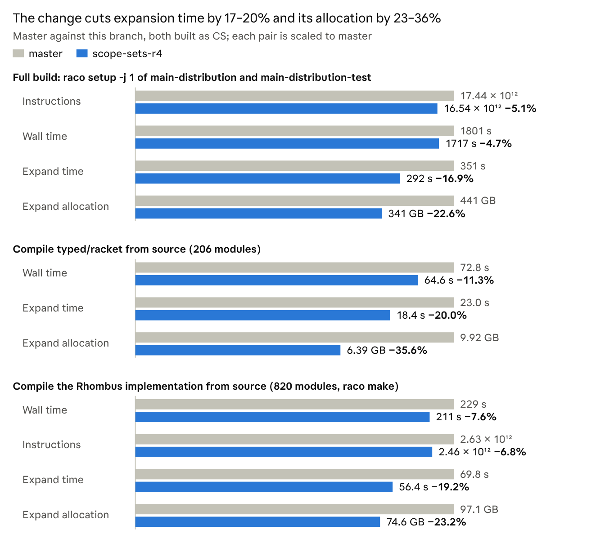
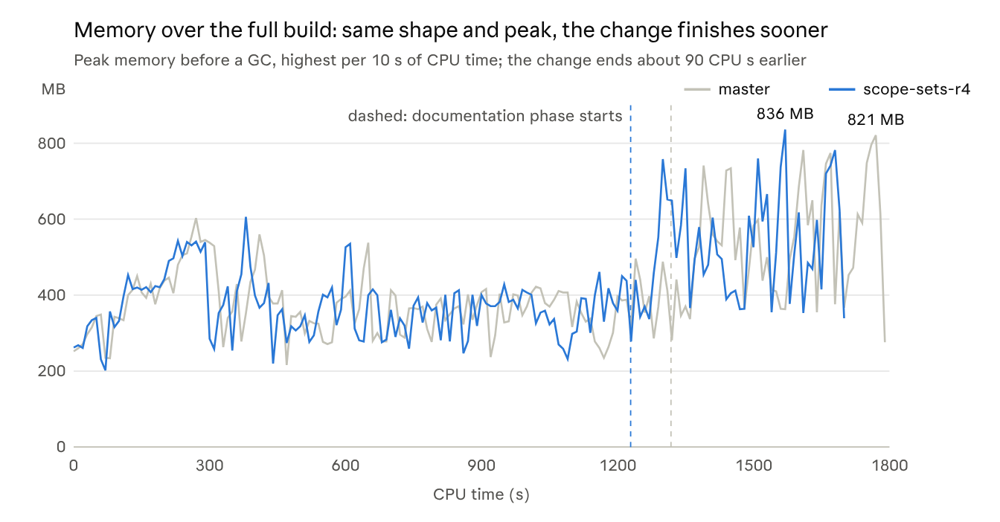

# Scope set representations for the Racket expander

Sam Tobin-Hochstadt · [racket/racket#5669](https://github.com/racket/racket/pull/5669), merged as [f1a34e208d](https://github.com/racket/racket/commit/f1a34e208d1a1103b1cbb5c5a78b200821e345d3)

A companion note, [Interned scopes and long modules](interned-scopes-and-long-modules.md), covers two cases found in review: ordering interned scopes first, and adding a list of scopes in one merge.

## Summary

This design changes how the expander represents scope sets and pending scope propagation. The scope-set model itself is unchanged. A scope set becomes a list of scopes sorted newest first, with tails shared between sets, plus a count and an incrementally maintained Zobrist hash. Interned scopes sort ahead of all other scopes, so adding and removing them touches only the front of a set. Pending propagation operations become a list in the same order, so composing them, applying them to a child, and adding or removing a list of scopes are merges. `resolve` tests candidate bindings without building the identifier's full scope set, and `syntax/cache.rkt` keeps only the resolve cache.

The sections below go from master to the final code in six steps, with the code for each step and what it changes.

The change was merged into racket/racket as one commit, [f1a34e208d](https://github.com/racket/racket/commit/f1a34e208d1a1103b1cbb5c5a78b200821e345d3), on master 51c0ade4b1. It was developed as three commits: the representation (df459b17b3), adding a list of scopes in one merge (ae557e7462), and sorting interned scopes first (afcaf895da). The measurements below were taken with the same three commits on master 45ccd1c43a; the upstream commits in between change neither the expander nor its generated code. Each commit includes the regenerated `expander.scm` and BC `startup.inc`, and the branch passes Racket's core tests and a parallel expansion stress test.

Against master, with both built as CS:



*Full build: one `raco setup` run per variant, `PLT_EXPANDER_TIMES` for expand. typed/racket and Rhombus: `raco make` from source.*

Peak memory is about the same: 1049 MB on master and 1036 MB with this change for the full `raco setup`. The one case that is slower is described under Cost model. The exact commands are under How the numbers were measured.

## Scope sets on master

On master, `syntax-scopes` is a `seteq`, an immutable `hasheq` keyed by scope. `set-add`, `set-remove` and `set-flip` update it, and `subset?` and `set=?` are hash-key comparisons. Binding tables key bindings on whole scope sets with `equal?`, so hashing a set calls `eq-hash-code` on every scope in it, which goes through the runtime's global weak table. `find-max-scope` scans the whole set for the newest scope.

Lazy propagation stores pending operations in `propagation-scope-ops`, a `hasheq` from scope (or shifted multi-scope) to `'add`, `'remove` or `'flip`. `propagation-add` and friends update it with `hash-set`, and `propagation-merge` composes two of them by iterating one into the other. `propagation-apply` iterates the table into each child's scope set one operation at a time, compares the result with the parent's set, and passes it through `cache-or-reuse-set`.

`resolve` calls `scope-set-at-fallback`, which adds the identifier's representative scope for each multi-scope at the phase to build a full set, then checks candidates against that set with `subset?`.

`syntax/cache.rkt` holds four caches: the resolve cache, the 16-entry `resolve+shift` cache, and two 8-slot rings (`cache-or-reuse-set` for scope sets, `cache-or-reuse-hash` for multi-scope sets) that recover some of the sharing interning would give.

## What the expander does with scope sets

These counts come from an instrumented copy of the expander run from source with `racket run.rkt -l racket/base` and `racket run.rkt -l racket` in `racket/src/expander`:

| Measure | Count or size |
| --- | --- |
| Scope-set size at `resolve` | median 6, p90 24, p99 102 |
| Size of newly created sets | median 6, mean 24; 20% have at most 2 scopes |
| Eager add/remove/flip | position of the scope in the set: mean 0.3 |
| Updates that touch only the first element | 82% |
| Pending operations per propagation | median 3, p90 19, p99 104 |
| `set=?` with equal counts (true / false) | 175k / 156k |
| Binding candidates per `resolve` | about 5 |

Almost every update touches one of the newest scopes. Equality tests are common, and half of those between same-size sets fail. Pending operations are composed and applied far more often than any one set is searched.

## From master, step by step

Each step below is a complete expander tree. To compare them, each tree was run from source on the same host Racket (master, built as CS), expanding and compiling `racket` and its dependencies in memory with `racket run.rkt -l racket`. Allocation is deterministic; time is the min of 2 runs and noisier.

| Step | Expand time | Expand allocation |
| --- | --- | --- |
| Master | 19.3 s | 6.79 GB |
| 1. Sorted list | 18.1 s | 6.32 GB |
| 2. Zobrist hash | 16.8 s | 6.32 GB |
| 3. Sorted pending operations | 15.1 s | 4.99 GB |
| 4. Remove a list of scopes in one merge | 14.9 s | 4.56 GB |
| 5. Resolve without building the union | 14.0 s | 4.28 GB |
| 6. Sibling memo instead of global caches | 13.7 s | 4.28 GB |

Step 2 changes only hashing, so it saves time but not allocation; steps 3 to 5 remove most of the allocation. Step 6 is about memory in deep expansions rather than speed.

### Step 1: a sorted list instead of a hash

A scope set becomes a struct holding a list of scopes in decreasing order of scope id, plus its size. New scopes get larger ids, so the newest scope is first:

```racket
(struct scope-set (elems   ; list of scopes, decreasing by id
                   count)
  #:authentic #:sealed)

(define empty-scope-set (scope-set null 0))
(define (scope-set-max s) (car (scope-set-elems s)))
```

Ids are exact rationals: representative scopes use fractions, and on a 32-bit platform very new scopes and interned scopes have bignum ids. Comparison therefore uses generic `>`, which Chez inlines with a fixnum fast path:

```racket
(define-syntax-rule (sc> a b)
  (> (scope-base-id a) (scope-base-id b)))
```

Interned scopes, from `make-interned-syntax-introducer`, are the exception to creation order. Rhombus uses one for each space, so it adds and removes them on every binding and reference, often on identifiers that already carry many scopes. They get ids above 2^59, so they sort as newer than every other scope and sit at the front of each set, where adding or removing one copies nothing else. No process can create 2^59 scopes, so ordinary ids never reach that range. `scope-set-max`, which picks the scope that holds a set's bindings, skips interned scopes unless the set has nothing else, because interned scopes are shared by all code that uses the same symbol:

```racket
(define interned-scope-id-base (expt 2 59))

(define (make-interned-scope sym)
  ... (define id (+ interned-scope-id-base (new-scope-id!))) ...)

(define (scope-set-max s)
  (define l (scope-set-elems s))
  (let loop ([p l])
    (cond
      [(null? p) (car l)]
      [(< (scope-base-id (car p)) interned-scope-id-base) (car p)]
      [else (loop (cdr p))])))
```

Adding, removing and flipping a scope share one search for the place where the scope is or would be. Each copies only the cells in front of that place and shares the rest of the list. Most updates are at the front, so they allocate one pair and a new struct:

```racket
;; `p` is the tail of `s`'s elements `l` that starts where `sc` is or would be
(define-syntax-rule (define-scope-set-update (name s sc) l p
                      #:present present-expr
                      #:absent absent-expr)
  (define (name s sc)
    (define l (scope-set-elems s))
    (let loop ([p l])
      (cond
        [(or (null? p) (sc> sc (car p))) absent-expr]
        [(eq? (car p) sc) present-expr]
        [else (loop (cdr p))]))))

(define (scope-set-with s sc l p)
  (scope-set (prefix-onto l p (cons sc p))
             (fx+ (scope-set-count s) 1)))

(define (scope-set-without s sc l p)
  (make-scope-set (prefix-onto l p (cdr p))
                  (fx- (scope-set-count s) 1)))

(define-scope-set-update (scope-set-add s sc) l p
  #:present s
  #:absent (scope-set-with s sc l p))

(define-scope-set-update (scope-set-remove s sc) l p
  #:present (scope-set-without s sc l p)
  #:absent s)

(define-scope-set-update (scope-set-flip s sc) l p
  #:present (scope-set-without s sc l p)
  #:absent (scope-set-with s sc l p))

;; Copy the elements of `l` that precede its tail `p` onto `tail`
(define (prefix-onto l p tail)
  (let loop ([l l])
    (if (eq? l p)
        tail
        (cons (car l) (loop (cdr l))))))
```

`make-scope-set` returns the single `empty-scope-set` for an empty list, so there is only one empty set.

Subset and equality tests walk both lists in order. They stop as soon as the remaining tails are `eq?`, which is common because sets share tails, or as soon as `b` has fewer scopes left than `a`:

```racket
(define (scope-set-subset? a b)
  (or (eq? a b)
      (let loop ([la (scope-set-elems a)] [na (scope-set-count a)]
                 [lb (scope-set-elems b)] [nb (scope-set-count b)])
        (cond
          [(eq? la lb) #t]
          [(null? la) #t]
          [(fx< nb na) #f]
          [else
           (define x (car la))
           (define y (car lb))
           (cond
             [(eq? x y) (loop (cdr la) (fx- na 1) (cdr lb) (fx- nb 1))]
             [(sc> x y) #f]
             [else (loop la na (cdr lb) (fx- nb 1))])]))))
```

Union, subtraction and `list->scope-set` are all one merge, through the same `scope-set-apply-ops` that propagation uses (Step 3), so none of them is quadratic.

Code that handles scope sets calls these `scope-set-*` operations instead of the generic ones from `common/set.rkt`, which stays as on master. `find-max-scope` becomes `scope-set-max`, and `apply-scope` takes separate operations for scope sets and for the `seteq`s of shifted multi-scopes:

```diff
 (define (add-scope s sc)
-  (apply-scope s (generalize-scope sc) set-add propagation-add))
+  (apply-scope s (generalize-scope sc) scope-set-add set-add propagation-add))
```

```diff
 (define (find-max-scope scopes)
-  (when (set-empty? scopes)
+  (when (scope-set-empty? scopes)
     (error "cannot bind in empty scope set"))
-  (for/fold ([max-sc (set-first scopes)]) ([sc (in-set scopes)])
-    (if (scope>? sc max-sc)
-        sc
-        max-sc)))
+  (scope-set-max scopes))
```

In this step pending operations are still a `hasheq`, so `propagation-apply` still adds them one at a time, now with `scope-set-add`, `scope-set-remove` and `scope-set-flip`. Binding tables still need `equal?` hashing on scope sets, and here it walks the list combining `eq-hash-code`s, which costs as much as master's. Step 2 fixes that.

### Step 2: a Zobrist hash code

Every scope gets a fixed pseudo-random key, computed from its id when it is created, so hash codes are as deterministic as ids. `scope` gets a parent struct, `scope-base`, holding the existing `id` and the new `key`, so `id` stays in field 0:

```racket
(struct scope-base (id key) #:authentic)

;; Ids can be bignums on a 32-bit platform; their low bits still
;; distinguish them, since each id comes from a distinct counter value
(define (fixnum-bits n) (if (fixnum? n) n (bitwise-and n #x1fffffff)))

(define (make-scope-key id)
  (cond
    [(fixnum? id) (mix id)]
    [(exact-integer? id) (mix (fixnum-bits id))]
    [else
     (mix (fx+/wraparound (fx*/wraparound (mix (fixnum-bits (numerator id))) 31)
                          (fixnum-bits (denominator id))))]))
```

```diff
-(struct scope (id             ; internal scope identity as an exact rational; used for sorting
-               kind           ; 'macro for macro-introduction scopes, otherwise treated as debug info
-               [binding-table #:mutable]) ; see "binding-table.rkt"
+(struct scope scope-base (kind           ; 'macro for macro-introduction scopes, otherwise treated as debug info
+                          [binding-table #:mutable]) ; see "binding-table.rkt"
```

A set's hash code is the `fxxor` of its scopes' keys, kept in the struct and updated in O(1) by every add, remove and flip. `equal?` hashing reads it, and equality rejects most unequal sets by comparing codes and counts before walking:

```racket
(struct scope-set (elems count code)  ; code = fxxor of scope keys
  #:authentic #:sealed
  #:property prop:equal+hash
  (list (lambda (a b eql?) (scope-set=? a b))
        (lambda (a hc) (scope-set-code a))
        (lambda (a hc) (scope-set-code a))))

(define (scope-set=? a b)
  (or (eq? a b)
      (and (fx= (scope-set-code a) (scope-set-code b))
           (fx= (scope-set-count a) (scope-set-count b))
           (let loop ([la (scope-set-elems a)] [lb (scope-set-elems b)])
             (or (eq? la lb)
                 (and (eq? (car la) (car lb))
                      (loop (cdr la) (cdr lb))))))))
```

### Step 3: pending operations as a sorted list

`propagation-scope-ops` becomes a list of `(scope . op)` pairs in the same newest-first order. Operations on shifted multi-scopes, which are rare, move to their own `hasheq` field:

```diff
 (struct propagation (prev-scs   ; owner's scopes before ops
                      prev-smss  ; owner's shifted multi scopes before ops
-                     scope-ops  ; scope -> (or/c 'add 'remove 'flip)
+                     scope-ops  ; list of (cons scope (or/c 'add 'remove 'flip)); see "scope-set.rkt"
+                     sms-ops    ; shifted-multi-scope -> (or/c 'add 'remove 'flip)
```

Operations compose with master's rules:

```racket
;; Result of performing `new` after `cur` (which can be #f), where
;; #f means no operation
(define (compose-op cur new)
  (case new
    [(add) 'add]
    [(remove) 'remove]
    [else (case cur
            [(add) 'remove]
            [(remove) 'add]
            [(flip) #f]
            [else 'flip])]))
```

With both lists sorted, `propagation-merge` composes them in one merge, `scope-ops-compose`. `propagation-apply` applies a list to a child's set in one merge, `scope-set-apply-ops`, which shares the set's tail beyond the oldest scope the list mentions and updates the count and hash code as it goes:

```diff
    [(eq? (propagation-prev-scs prop) scs)
     (syntax-scopes parent-s)]
+   [(null? (propagation-scope-ops prop)) scs]
    [else
     (define new-scs
-      (for/fold ([scs scs]) ([(sc op) (in-immutable-hash (propagation-scope-ops prop))]
-                             #:when (not (shifted-multi-scope? sc)))
-        (case op
-          [(add) (set-add scs sc)]
-          [(remove) (set-remove scs sc)]
-          [else (set-flip scs sc)])))
+      (scope-set-apply-ops scs (propagation-scope-ops prop)))
```

```racket
;; Operations equivalent to `base` followed by `new`
(define (scope-ops-compose base new)
  (let loop ([b base] [n new])
    (cond
      [(null? n) b]
      [(null? b) n]
      [else
       (define bsc (caar b))
       (define nsc (caar n))
       (cond
         [(eq? bsc nsc)
          (define op (compose-op (cdar b) (cdar n)))
          (if op
              (cons (if (eq? op (cdar b)) (car b) (cons bsc op))
                    (loop (cdr b) (cdr n)))
              (loop (cdr b) (cdr n)))]
         [(sc> bsc nsc) (cons (car b) (loop (cdr b) n))]
         [else (cons (car n) (loop b (cdr n)))])])))
```

A propagation with no scope operations, or no multi-scope operations, leaves that part of each child alone, where master iterated the whole table for both.

### Step 4: add or remove a list of scopes in one merge

With sorted lists, adding or removing many scopes one at a time would be quadratic: each operation inserts into a list, and going newest first puts each new scope or operation at the end, copying the list each time. The expander removes all of a module's use-site scopes from each body form, and it records those use-site scopes for serialization by adding them all to an empty syntax object. A module with thousands of macro uses in definition positions has thousands of use-site scopes. A `racket/base` module with 8,000 definitions whose right-hand sides each use a macro expands in 274 ms and allocates 483 MB, against 345 ms and 554 MB on master; adding its use-site scopes one at a time would allocate 1,036 MB. `add-scopes` and `remove-scopes` therefore turn the scopes into one sorted operation list and apply it with one merge:

```racket
;; Adding or removing several scopes at once builds the operations
;; with one merge, instead of one insertion per scope
(define (remove-scopes s scs)
  (cond
    [(null? scs) s]
    [(null? (cdr scs)) (remove-scope s (car scs))]
    [(for/and ([sc (in-list scs)])
       (and (scope? sc) (not (representative-scope? sc))))
     (apply-scope-ops s (list->scope-ops scs 'remove))]
    [else
     ;; Multi-scopes are tracked separately from other scopes
     (for/fold ([s s]) ([sc (in-list scs)])
       (remove-scope s sc))]))

;; `add-scopes` is the same with `add-scope` and 'add
```

`list->scope-ops` lives next to the representation in `common/scope-set.rkt`. It sorts the scopes newest first unless they already are, and drops duplicates. `apply-scope-ops` applies the list to the syntax object's own set with `scope-set-apply-ops` and composes it into the pending operations with `scope-ops-compose`.

### Step 5: resolve without building the union

An identifier's full scope set at a phase is its own scope set plus a representative scope for each of its multi-scopes. Representatives are old, so adding them to a newest-first list copies most of it on every resolve-cache miss. Instead, `resolve` collects the representatives in a short list and checks each candidate against the union without building it:

```diff
-      (define scopes (scope-set-at-fallback s (fallback-first smss) phase))
+      (define reps (representatives-at-phase (fallback-first smss) phase))
 ...
-                    #:when (and b-scopes binding (subset? b-scopes scopes)))
+                    #:when (and b-scopes binding (scope-set-subset-of-union? b-scopes scs reps)))
```

```racket
;; Is `a` a subset of the union of `b` and the scopes in the list
;; `extras`? The `extras` list is expected to be short.
(define (scope-set-subset-of-union? a b extras)
  (cond
    [(null? extras) (scope-set-subset? a b)]
    [else
     (let loop ([la (scope-set-elems a)] [lb (scope-set-elems b)])
       (cond
         [(eq? la lb) #t]
         [(null? la) #t]
         [else
          (define x (car la))
          (cond
            [(memq x extras) (loop (cdr la) lb)]
            [else
             (let b-loop ([lb lb])
               (cond
                 [(null? lb) #f]
                 [(eq? x (car lb)) (loop (cdr la) (cdr lb))]
                 [(sc> x (car lb)) #f]
                 [else (b-loop (cdr lb))]))])]))]))
```

`representatives-at-phase` drops duplicates, because two shifted multi-scopes can have the same representative and the `#:exactly?` count check in `resolve` relies on a list without them. `scope-set-at-fallback`, which other callers still use to get the full set, is defined in terms of it, so the phase logic is in one place.

### Step 6: a sibling memo instead of global caches

With cheap comparison and hashing, the `resolve+shift` cache and both `cache-or-reuse` rings in `syntax/cache.rkt` no longer pay for themselves, and they go. The resolve cache stays (without it, expand time rises about 7%).

`cache-or-reuse-set` existed to recover sharing in deep expansions, such as the nested `let`s from a many-argument `or`. Siblings that need the same new set start from the same set, so `syntax-propagated-content*` now remembers the last input set and its result while it walks a syntax object's children:

```racket
(define last-scs #f)
(define last-new-scs #f)
(define (apply-to-scopes scs)
  (cond
    [(eq? scs last-scs) last-new-scs]
    [else
     (define new-scs (propagation-apply prop scs s))
     (set! last-scs scs)
     (set! last-new-scs new-scs)
     new-scs]))
```

The memo lasts one pass over the children, so it needs no shared state and no set comparisons. On a module containing `(define (f x0 ... x1499) (or x0 ... x1499))`, expanded with `racket run.rkt -t or1500.rkt`, peak resident memory is 249 MB, against 284 MB with master's ring and 371 MB with neither.

## Serialization

A scope set serializes with its own `#:scope-set` tag followed by its scopes, oldest first, and the commit increments the version to 9.4.0.6 for the new format. Scopes get fresh ids when they are deserialized, so the reader sorts the elements again with `list->scope-set`. Top-level namespace scope swapping (`compile/namespace-scope.rkt`) mixes scopes and multi-scopes, so it keeps using `seteq`s and converts at that boundary.

## Concurrency

Scope sets and operation lists are immutable, and a scope's id and key are set at construction, so threads can share them freely. The sibling memo is local to one propagation pass. The design adds no global state, and hashing a set does not touch the runtime's global weak table. A stress test with 4 threads and 4 places, each expanding 30 macro-using modules in its own namespace, matches the single-threaded results.

The representation depends on distinct scopes having distinct ids, since otherwise the sorted list for a set would not be unique and `scope-set=?` could fail on equal sets. The id counter is a single box for the whole process (an ordinary module-level variable, not a place-local one), updated with `box-cas!`, so ids are unique across threads and places. Syntax objects cannot move between places, but on Racket CS all places share the expander's own scopes created when it starts, such as `core-scope`, so new scopes in any place must not reuse their ids. Interned scopes take their ids from the same counter, offset by 2^59, so they are unique too. The header comment of `common/scope-set.rkt` states this requirement.

## Cost model

An operation on a scope costs time and space in proportion to the number of scopes in the set that are newer than it. That is cheap for the newest scopes, where almost all updates happen, but changing an old scope in a large set copies every newer cell, where a `hasheq` pays a logarithmic cost.

Flipping one scope of an identifier that has N scopes, 200,000 times:

| N | Scope flipped | master | this change |
| --- | --- | --- | --- |
| 4 | newest | 250 ns, 128 B | 133 ns, 96 B |
| 4 | oldest | 231 ns, 128 B | 167 ns, 144 B |
| 16 | oldest | 218 ns, 224 B | 298 ns, 336 B |
| 64 | oldest | 205 ns, 272 B | 460 ns, 1.1 KB |
| 1024 | newest | 276 ns, 416 B | 126 ns, 96 B |
| 1024 | oldest | 267 ns, 416 B | 11.7 µs, 16.9 KB |

The pattern that produces old-scope operations in real expansion is a macro that calls `local-expand` on its body: its introduction scope is older than every scope created inside, and it is flipped over the result. With such macros nested D deep:

| Nesting depth | master | this change |
| --- | --- | --- |
| 10 | 1.23 s, 774 MB allocated | 0.64 s, 459 MB |
| 25 | 2.25 s, 1.88 GB | 1.28 s, 0.78 GB |
| 50 | 4.6 s, 3.54 GB | 3.0 s, 1.60 GB |
| 75 | 6.6 s, 4.32 GB | 6.9 s, 2.34 GB |
| 100 | 10.6 s, 6.04 GB | 15.6 s, 3.59 GB |

The change is about twice as fast up to depth 25, about even at 75, and 47% slower at 100, while allocating less at every depth. For scale, while compiling `racket` half of the scope sets created have 6 or fewer scopes and 90% have 40 or fewer.

The teaching languages are a heavy real user of this pattern: they `local-expand` to control the order of error messages. Large and deeply nested programs in them are faster with the change and allocate much less:

| Program | master | this change |
| --- | --- | --- |
| ISL, `local` nested 1000 deep | 591 ms, 908 MB | 528 ms, 248 MB |
| ASL, `let` nested 1000 deep | 796 ms, 1489 MB | 747 ms, 459 MB |
| BSL, `cond` nested 1000 deep | 262 ms, 408 MB | 220 ms, 229 MB |
| ISL+, `lambda` nested 1000 deep | 230 ms, 366 MB | 195 ms, 122 MB |
| BSL, 2,000 functions | 3916 ms, 8295 MB | 2623 ms, 5911 MB |
| ISL, 2,000 functions | 1686 ms | 1432 ms |

Because interned scopes sort first, adding and removing one costs the same at any depth. Adding and removing an interned scope on an identifier inside D nested `let`s, 20,000 times:

| D | master | this change |
| --- | --- | --- |
| 10 | 9.1 ms, 23 MB | 8.3 ms, 16 MB |
| 100 | 10.7 ms, 29 MB | 9.0 ms, 17 MB |
| 1000 | 87.2 ms, 183 MB | 86.7 ms, 46 MB |

If interned scopes were ordered by creation like other scopes, they would be the oldest scopes in every set, and the depth-1000 case would take 385 ms and 1.3 GB.

Deeply nested Rhombus programs combine both patterns. Nested `block` and `fun` forms 100 and 300 deep are 9 to 14% faster than on master. At 1000 deep, `block` is within 1% of master and `fun` is 13% slower (9.2 s against 8.2 s). Every one of them allocates less, down to 72% of master for `fun` at 1000.

## The full build in detail

These numbers come from the full build described under How the numbers were measured: one `raco setup -j 1` of `main-distribution` and `main-distribution-test` per variant, master against `scope-sets-r4`. The chart follows build-plot.racket-lang.org, which plots memory at each GC against CPU time.



*Data: [`data/buildplot/gc-memory.csv`](data/buildplot/gc-memory.csv), every GC of one `raco setup -j 1` run per variant, highest per 10 CPU seconds.*

Memory has the same shape over the whole build. Both peaks fall in the documentation phase, where the expander does little, and the highest memory left after a major GC is the same (667 MB on master, 665 MB with the change). The change runs 6.6% fewer collections (200,743 against 214,829).

### Where the time goes

|  | master | scope-sets-r4 | change |
| --- | --- | --- | --- |
| Wall time (s) | 1801 | 1717 | −4.6% |
| CPU time, user + sys (s) | 1791 | 1706 | −4.8% |
| Instructions (×10¹²) | 17.436 | 16.541 | −5.1% |
| Compiling collections (s) | 1323 | 1235 | −6.7% |
| Building documentation (s) | 472 | 476 | +0.8% |
| Expander `expand` (s) | 350.9 | 291.5 | −16.9% |
| Expander `expand` allocation (GB) | 440.5 | 341.0 | −22.6% |
| Expander `eval` (s) | 476.8 | 471.7 | −1.1% |
| Expander `compile` (s) | 257.2 | 259.7 | +1.0% |
| Expander `read` (s) | 41.6 | 42.3 | +1.8% |
| Linklet compile (s) | 211.9 | 214.3 | +1.1% |
| Linklet run and instantiate (s) | 254.5 | 253.7 | −0.3% |
| Total GC time (s) | 544 | 521 | −4.3% |

The expander rows come from `PLT_EXPANDER_TIMES` and the linklet rows from `PLT_LINKLET_TIMES`. Expansion is the only region that moves by more than the noise of a single run: about 59 s of the 88 s saved in compiling collections, with most of the rest in GC. Both builds schemify and compile the same 182,719 linklets, and schemify takes 27.0 s in each.

### Startup and load

Loading compiled code deserializes every syntax literal, so it is where the new serialized form and the sort on load would show. Medians of 10 alternating runs, pinned to one performance core of the Core Ultra 7 265 machine, in instructions:

| Command | master | scope-sets-r4 | change |
| --- | --- | --- | --- |
| `racket -n -e ''` | 199.13M | 199.13M | 0% |
| `racket -l racket/base` | 359.98M | 359.47M | −0.14% |
| `racket -l racket` | 1063.1M | 1061.4M | −0.17% |
| `racket -l typed/racket` | 2118.7M | 2088.6M | −1.42% |
| DrRacket's code (`-l drracket/private/link`) | 10.284G | 10.218G | −0.64% |

Peak RSS is within 0.4% for every command, and memory retained after loading and a major GC differs by at most 0.15 MB (about 54.8 MB for `racket/base`, 82.1 MB for `racket` and 109.0 MB for `typed/racket`).

### Compiled code

Compilation stays deterministic. Compiling 756 modules (from `racket`, `typed/racket`, `scribble/manual`, `pict`, `json`, `net/url` and `rackunit`) from scratch twice, once serially and once with `-j 6` in reverse order, gives byte-identical `.zo` files for 755 of them in each tree. The one exception, `syntax-color`'s `racket-lexer_rkt.zo`, also varies between runs on master.

Between master and the change, 141 of those files are identical and 615 differ. In 40 sampled files, compiled machine-independent and compared with `zo-parse`, every code linklet is identical and only the syntax-literal data differs: scope sets are written with the `#:scope-set` tag where master writes `#:seteq`, and the empty scope set is one shared entry, which shifts later indices. Over the 7,657 `.zo` files of the full build, total size grows by 174,017 bytes (+0.05%).

### Rhombus

Rhombus is the most expansion-heavy of the three workloads in the Summary chart. Compiling its implementation from source covers every module of the 28 Rhombus `-lib` packages (`rhombus-lib`, `shrubbery-lib`, `enforest-lib`, the pict, draw, gui and scribble bindings, and so on), without tests or docs. Expansion is 31% of master's time there, against 20% in the full build, so the whole compile gets 7.6% faster. Instructions drop 6.8% and cycles drop 7.9%. Peak RSS goes up 3.7%, from 1178 MB to 1222 MB.

## Testing

`common/scope-set.rkt` has a `test` submodule (`raco test common/scope-set.rkt`) that runs 200,000 random operations against `hasheq` reference sets. It builds sets from one another so that they share tails. It includes fractional ids and ids above 2^59, which are interned ids, and bignums on a 32-bit platform. It checks every exported operation, the count, the hash code, the scope that `scope-set-max` picks, and that an operation that changes nothing returns the same set. Racket's core tests and the parallel stress test pass on the built change.

Racket BC, built from the representation commit with its regenerated `startup.inc`, passes the core test suite (`tests/racket/test`): all 526,236 expression tests, including the threads and places tests in `par.rkt`.

## Optional follow-on changes

Two independent changes build on this one and are on their own branches, each one commit on top of `scope-sets-r4` that passes the core tests. On the full `raco setup` neither is a clear gain:

| Branch | What it does | Instructions vs this change | Peak RSS vs this change |
| --- | --- | --- | --- |
| `syntax-context-r4` (a6f17c1669) | Holds a syntax object's shifted multi-scopes, module-path-index shifts and inspector in one shared immutable record, shrinking syntax objects from 64 to 48 bytes | +0.17% | +0.5% |
| `bulk-binding-index-r4` (add85ce5a8) | Gives a binding table with several bulk bindings an index from symbol to bulk bindings, built only after its lookups have cost more than building it would | −0.3% | −1.8% |

The shared context record cuts expansion allocation by 3.2% when loading `racket` from source, but that is too small a share of a full build to show. The bulk-binding index saves 4.2% of instructions compiling `math` and 1.4% compiling `rhombus`, and is within noise elsewhere.

## How the numbers were measured

Both trees are built as CS with `make base`, with the same packages installed. The typed-racket workload compiles `typed/racket` and the 206 modules of a source checkout of typed-racket-lib, with every other dependency already compiled. Before each run, the checkout's `compiled` directories are removed:

```
PLTCOLLECTS="$TR/typed-racket-lib:" PLT_EXPANDER_TIMES=1 raco make typed/racket.rkt
```

`raco make` compiles one module at a time. Expand time and allocation are the `expand` row of the `PLT_EXPANDER_TIMES` report, and wall time is the whole command.

The per-step numbers use the expander run from source in `racket/src/expander` of each tree, on the same host:

```
PLT_EXPANDER_TIMES=1 racket run.rkt -l racket
```

The full-build numbers reproduce what build-plot-cs.racket-lang.org measures, on an Intel Core Ultra 7 265 under Linux. Each variant is minimal Racket CS built with `make base`, with `main-distribution` and `main-distribution-test` installed with `--no-setup` from one local snapshot of the package catalog, so all variants compile identical sources. The measured step, pinned to one performance core:

```
perf stat -e cpu_core/instructions/u,cpu_core/cycles/u \
  env PLT_EXPANDER_TIMES=1 racket -W "debug@GC error" -l- raco setup -j 1
```

All variants compile the same 1294 collections and build the same documentation with no errors. Each ran once, with the variants running at the same time on separate cores, so time differences under 1 to 2% are noise; instruction counts are steadier.

The cost-model tables use `old-scope.rkt` (flip one scope of an identifier with N scopes) and `deep.rkt` (nested `local-expand` macros), run with each built Racket. Both files are in [`benchmarks/`](benchmarks/).

The teaching-language and interned-scope tables come from programs generated by `gen.py` and `gen2.py` in [`data/ryan/`](data/ryan/); the interned-scope and deep Rhombus results are in [`data/interned-first/results/`](data/interned-first/results/), and the long-module programs and results are in [`data/add-scopes/`](data/add-scopes/). Each program is expanded with each built Racket on one otherwise idle P-core, and each number is the minimum of 5 expansions after a warm-up. The summary chart, the step table, the full build, the startup numbers and the teaching-language table were measured on the first commit. The other two commits do not change them measurably: compiling typed/racket and the Rhombus `-lib` packages with and without them gives the same instruction counts within 0.2% and the same allocation.

The startup and load numbers use the same two builds: `perf stat` over 10 runs of each command, alternating master and the change, pinned to one performance core of the same machine, reporting medians. The `.zo` comparisons use those trees too. The raw build logs, GC log extracts, startup runs and scripts are in [`data/`](data/).

The Rhombus numbers use the same two trees, with the `rhombus` package and its dependencies installed from one snapshot of the package catalog, so both trees have the same 28 packages with identical checksums. Each run deletes the compiled files of those 28 packages and then runs one `raco make` of a generated module that requires all 820 of their source modules, so it compiles 822 modules while every non-Rhombus dependency stays compiled. Every run read the same modules (32,888 or 32,889 expander reads). There are 3 rounds, each running one process at a time on an otherwise idle P-core and alternating which tree goes first, and the chart shows medians. Master's runs span 227.9 to 230.5 s and the change's span 210.5 to 211.6 s. The data is in [`data/rhombus/recheck/`](data/rhombus/recheck/); the files directly in `data/rhombus/` are from an earlier method that did not compile the same modules every run.

## Rejected ideas

| Idea | Why it loses |
| --- | --- |
| Sorted flat vectors | Every remove copies the whole set (34 scopes on average); no gain. |
| Inline the first one or two scopes in the struct | Struct grows from 4 to 6 words after alignment, and most adds still need a pair, because only 20% of sets have at most 2 scopes. Allocation +0.7%, expand time +5%. |
| Inline only the newest scope, packing the count and a 40-bit hash into one fixnum so the struct stays 4 words | Every set saves one pair, but scope sets are under 1% of compile allocation (about 0.7 of 91 GB for typed-racket). Instructions −0.1% to +0.9% across Scribble, typed-racket, math and Rhombus; allocation unchanged. |
| Nodes of up to 3 scopes, each pointing to a tail that is itself a scope set | Most changes hit the head, and copying a 6-word node costs more than one pair. Instructions +0.2% to +1.2%, allocation +0.5%. |
| Immutable chunks of 4 or 8 scopes | Adding at the front copies the front chunk instead of one pair. Allocation +2.2 to +2.5%, expand time +5 to +12%, higher peak memory. Cheap front adds would need Bagwell-style VLists that claim slots with CAS, and the set struct would still dominate. |
| Hash-consing or a hash-consed trie of sets (rustc `SyntaxContext`, BDD unique tables) | Makes `set=?` an `eq?` test, but needs one global weak table shared by every place. A lossy lock-free version gave no gain, and tail sharing already provides the trie. |
| Memoized (set, op) results; global caches of recent sets, multi-scope sets, or shifted resolutions | The hash code makes comparisons cheap and the sibling memo gets the sharing; turning all three caches off made `racket` expand about 4% faster. |
| Skew-binary jump pointers for subset tests (Myers 1983) | Subset walks already stop at a shared tail, and sets are short. |
| Represent a set by its generators (maximal scopes) | Flips and use-site removals break the implication, so subset tests need DAG reachability. |
| ZDDs, set-tries or bit signatures for resolve | Each resolve sees about 5 candidates, and only 4k of 170k subset tests fail. |
| (symbol, phase, set) resolve memo | Only 35k of 173k resolve misses repeat a key. |
| Patricia tries | Log-depth path copying where the list touches one or two cells. |
| Fixnum order keys instead of rational ids | Only 5% of id comparisons involve a ratio; ceiling under 1%. |
| Per-table bulk-binding symbol index, built eagerly | Most resolve candidates are bulk-binding misses, but a table is replaced on every bulk-binding addition, so an eager index is rebuilt each time: allocation +23%, peak memory +8%, no time gain. The gated version under Optional follow-on changes avoids this. |
| Chunked bitsets over a dense scope index | Allocation −1.3% and time flat; loses tail sharing, and scope sets are about 6% of expansion allocation to begin with. |
| Return the same syntax object when an operation leaves an identifier's set unchanged | 87k of 904k operations on identifiers are no-ops: at most 0.13% of allocation. |
| One object per pending operation instead of two pairs | Operation cells are 34.5 MB of 4.28 GB: at most 0.4% of allocation. |
| Share list suffixes among deserialized scope sets | All pairs in the heap after loading racket and expanding a module are 2.9 MB of 50 MB live: under 1%. |
| A second structure for large sets, to bound old-scope operations | Both structures would have to agree on equality and hashing, for a case that only appears with local-expand nested past depth 75. |
